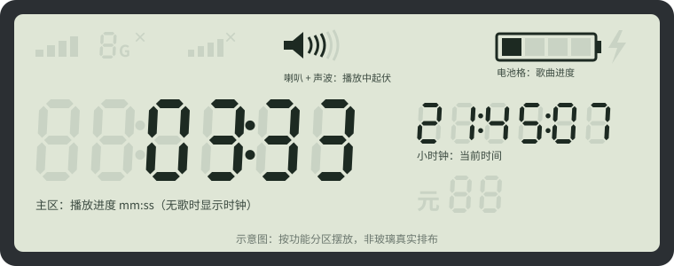

# Monita-CS80 · 开发计划 (PLAN)

> 一台拉卡拉 CS80 收银客显屏，在 R05 原厂基带上跑自己写的原生 app，变成 Mac 的副屏：
> 800×1280 大屏是主力，段码屏做个好看的展示。

---

## 当前状态（2026-11）

**已经有的**：

- `fw/`：R05 原生 app 工具链跑通（core_stub 哈希、导出表、2PPA 打包、按 loader 规则静态校验）。
  - **主 app = USB 通道 + 大屏推帧（第 1、2 步固件侧完成，实机跑通）**：port 4 收帧（`link/proto.h`，主机单测 `sh fw/link/test.sh`），
    RECT/PRESENT/SEG/BACKLIGHT/FBCRC/PING；开机版权页（fw v7）+ 段码屏 `------` + HELLO 校时后的小时钟；看门狗照原厂。
  - **开机版权页（fw v7，待上机）**：`fw/lcd/bootscreen.h` 画在前台缓冲，EDK2 UEFI 8×19 字体 2 倍放大（`tools/gen_font.py` 生成 `font_uefi.h`）；
    动态行：版本、构建日期、堆剩余、缓冲块数（三缓冲 x3 OK / 降级 WARN）、段码屏 GPIO 初始化；Link 行 WAIT，第一条 HELLO 改 OK。
    主机单测和设计稿参考渲染（`tools/bootscreen/render_ref.py`）逐像素一致。
  - **三缓冲（fw v6，当前在机）**：R05 内核堆实测还有 4.3 MB 连续空间，开机 malloc 第二、三块 fb；扫描基址帧头锁存，PRESENT 立即翻页、下一批直接画第三块。
    拿不到第三块退回双缓冲（帧事件 `0x08807008`，周期 26.6 ms），再不行单缓冲。
  - 实测：裸链路 ≈ 8 MB/s；整帧 ≈ 320 ms（单缓冲）/ 390 ms（双缓冲）；小块差分 ≈ 5 ms（单）/ 52 ms（双，主要在等帧）；0 丢包，回读 CRC 一致。
  - `DIAG`（0x50）诊断命令：堆、最大块、扫描基址、LCDC 寄存器、帧事件计时/相位、双缓冲开关。
  - 段码屏驱动 `fg00.h` 实机点亮（pin95 EN 修复、开机不调 onoff），映射 `segmap.h` 全部确认。
  - 诊断：`diag/probe`（USB 口心跳）、`diag/segtest`（888888↔123456）、`diag/segprobe`（逐段点亮对照）、`lcd/lcd_test`（纯色轮换）。
- `tools/host-ref/`：**Python 参考上位机**（pyserial；Pillow 可选）：hello / ping / pattern / png / bench / diffdemo / seg / teartest，有单测。
- `mac/`：Swift 渲染器（CDE 风格歌词页 + 锁屏），CoreGraphics 画 800×1280 → 32×16 tile 差分。
  - **`--device /dev/cu.xxx` 直连 R05 固件**（RGB565，脏 tile 合并成矩形 + PRESENT；`MonitaCore/Link.swift` 有测试），
    直连模式下不跑任何旧 host 轮询。**Mac 实机已通（2026-11-18）**：macOS 上没有 `cu.*`（接口是厂商类 0xFF、不绑驱动），
    改用 IOUSBHost 直接开接口 7 走 bulk（`mac/Sources/monita-cs80/UsbLink.swift`，`--device usb`）。
    `--bench` 实测：PING 0.4 ms，整帧（双缓冲）≈ 374 ms / 5.5 MB/s，裸吞吐 8.6 MB/s，小块差分 ≈ 53 ms，FBCRC 一致，SEG ≈ 25 ms。
  - **歌词滚动（已上机）**：协议加 COPY（0x22，设备端搬块，`caps` bit2），渲染器切句时 easeOutCubic 滑动，
    每帧只发 COPY + 新露出条带（`MonitaCore/Scroll.swift`，离线 `--scroll-sim`：首帧 ≈ 540 KB，之后 ≈ 10–34 KB/帧，逐像素重建一致）。
    固件 v4/v5 已上机：默认立即翻页，跨缓冲 COPY（`fw/link/blit.h`）。歌词区滚动 55 ms/帧（v2 时 72–97 ms），FBCRC 一致。
    Mac 上 Swift `--bench` 测 v5：立即翻页 52.2 ms/帧，等帧 79.1 ms。瓶颈是翻页后旧前台要等下一个帧头才不被扫描，所以每批固定占两个帧周期。
    **fw v6 三缓冲**（`fw/link/tribuf.h`，`caps` bit3）已上机：PRESENT 之后下一批直接画第三块，实测滚动 41 ms/帧（≈ 24 fps，上限 37.5 fps）。第三块拿不到时退回双缓冲（DIAG 31 报原因，DIAG 32 可切块数）。
  - **零拷贝滚动研究（fw v3，结论）**：扫描基址 `0x08807034` 帧头锁存 → 做不了光栅分屏；0x3c/0x40 是另一个整屏源，没有窗口/叠加层；
    只剩"整屏偏移"（基址指到缓冲内任意行）可用，对只滚歌词区没帮助，所以滚动走 COPY + 三缓冲。
  - **段码屏展示模式**（`MonitaCore/SegFrame.swift`，Mac 侧算帧发 SEG）：播放进度/总时长、声波动画、Mac 电量 + 充电闪电，见 [docs/segmap.md](docs/segmap.md)。
  - 不加 `--device` 时仍走"兼容旧链路"（第三方 host 的 HTTP 接口，只做接口互操作，仓库里不含它的代码），等直连在 Mac 上测通再删。
- `tools/lyrics/`：当前播放（mediaremote-adapter）+ 网易云歌词，`lyrics.py serve` 自带 HTTP 服务，
  Swift 用 `--lyrics http://127.0.0.1:8788` 直接从它拿歌词，不再经过 host。

**待确认 / 还依赖旧 host 的**：翻页的肉眼撕裂检查（`cs80.py PORT teartest`）；
Agent 会话数（直连模式下暂时没有，见下"顺带要做的"）。

---

## 功能设计

### 大屏（主力）

- 现有两个画面保留：CDE 风格歌词页（封面、四行歌词带翻译、进度条、Front Panel 实时数据），锁屏页（壁纸 + 时钟 + "<名字> 暂时不在"）。
- 锁屏留言的名字是配置项：`--name` 或 `MONITA_AWAY_NAME`，默认"主人"。
- 推帧：Swift 直接开 USB 口，走 [docs/protocol.md](docs/protocol.md) 的 TILES/PRESENT。tile 差分、帧键省电、锁屏降频这套逻辑不变，只换传输层。
- 防撕裂：固件"追光"写入——等扫描线扫过一个条带再写这个条带，一批 tile 落在同一次刷新里（背景见 [r05-notes.md §4](docs/r05-notes.md)）。
- 断开时：大屏保持最后一帧（以后可以画一个"未连接 + 时钟"的本地画面）。

### 段码屏（展示用）

维护者自己基本不看它，定位是"给别人看的、炫一下"，所以只做一个**简单好看的展示模式**，不承载复杂状态：

- 已实现（Mac 侧算帧，细节见 [docs/segmap.md](docs/segmap.md)）：主区播放进度 `mm:ss`（没在放歌时 `hh:mm` 时钟）；
  小时钟显示歌曲总时长 / 日期；声波跳动动画，暂停只亮喇叭；电池框 + 四格 + 闪电 = Mac 电量与充电状态。
- 断开（5 s 没有 SEG）时固件独立走时钟。
- 以后：固件自己按播放状态外推进度（SEG_STATE），Mac 不必一直发整帧显存。
- 其它图标（元88、8G、信号、WiFi、×）先不用。

### 按键

- `+` / `−`：Mac 音量。
- 左边两键：播放/暂停、切页（歌词页 ↔ 以后的其它页）。
- 引脚：模组脚 99 / 13 / 14，低有效、上拉输入（来自 QDisplay 的 R03 资料，见 r05-notes.md §7）；R05 上的 `ql` GPIO 号待从原厂 app 里核对。
- 固件消抖后发 KEY 事件给 Mac，由 Mac 执行（媒体键 / 音量）。

---

## 开发顺序

1. **USB 通道**：固件 port 4 + HELLO/PING/ACK，Windows 实机通（COM5）。Mac 上走 IOKit bulk（接口 7）✅，termios 串口留给 Linux。
2. **大屏推帧（主线）**：固件 RECT/PRESENT ✅；Swift `--device usb` ✅（Mac 实机）。
   Mac 上测通后删掉 `mac/` 对旧 host 的依赖（`/api/patch`、`/api/frame`、`/api/status`、`/api/heartbeat`、`/api/screensaver`、`/api/layout`）。
3. **防撕裂**：帧事件位已找到（`0x08807008` 的 0x04，26.6 ms），基址确认帧头锁存，三缓冲已上机 ✅。剩下：肉眼确认翻页干净；
   单缓冲退路的"追光"写入（只在拿不到第二块时需要）。
4. **按键**：核对 R05 的 ql GPIO 号 → 消抖 → KEY 事件 → Mac 侧媒体控制。
5. **段码屏展示模式**：Mac 侧展示模式 ✅；以后 SEG_STATE + 固件外推进度。

### 顺带要做的

- **歌词数据源**：现在用 `tools/lyrics/lyrics.py serve`（标准库就够，已有测试）。这是最简单的做法，先这样。
  以后想少一个进程，再把它搬进 Swift：mediaremote-adapter 的 `stream` 子进程 + 网易云 `music.163.com/api/song/lyric?id=&lv=1&tv=1`（带 Referer）。
- **Agent 会话数**：现在读旧 host 的 `/api/data/agents`。第 2 步之后换成 Swift 本地扫 Claude 会话目录：
  默认 `$CLAUDE_CONFIG_DIR/projects`（没设就是 `~/.claude/projects`），再加一个用户可配置的额外 glob 列表（多账号时用），
  按 jsonl 的最后一条判断 running/waiting。
- 固件：任务里喂狗/看门狗策略、USB 断开重连。
- LaunchAgent 安装脚本（`mac/com.monita.cs80.plist.example` 是模板）。
- **经 USB 自更新 app**：现在刷 app 必须把线换到 Windows 走下载模式（macOS 认不出下载态）。
  想法：主机把新 app 分块推给正在跑的固件，固件校验整包 CRC 后写进 app 槽再重启。
  难点：app 是从同一块 NOR 上 XIP 执行的，写自己所在的槽要先把写入代码搬进 RAM、关中断/挂起其它任务；
  写到一半断电会变砖（基带不受影响，仍能回 Windows 下载模式救）。需要先确认 R05 导出里有可用的 flash 擦写接口。

---

## 坑（别重犯）

- **段码屏 EN 在 pin95（func5）**，不是原厂驱动里写的 pin4；它藏在原厂 enter 的引脚默认表里，我们不跑那张表就得自己补。
- **GPIO10 高 = 亮**。原厂叫 `onoff(1)` 的函数实际是熄屏，开机别调。
- **`ql_rtos_task_create` 是 7 个参数**，优先级别超过内核上限（用 12）。
- **enter 里不能阻塞**，只建任务就返回。
- **桩表里一个哈希查不到，整个 app 不加载**——导入清单里只写导出表里有的名字。
- 不许编出 NEON/VFP 指令、不许编译器偷偷插 memset/memcpy（`build.sh` 的 CFLAGS 已经管住，`validate.py` 也会查）。
- app 不能超过 0xa09a0 字节，后面紧挨着 AP 资源区。
- 刷机前一定要有整片 8 MiB 备份。
- **DIAG 回包最多 16 个字（68 B）**。fw v3 之前 `reply()` 的缓冲只有 48 B 载荷，13 个字以上的回包会写穿栈导致复位（v4 已修）。
  早先记的"读 LCDC `0x08807040` 起复位"和"W1C 0x40/0x80 复位"大概率都是这个缺陷。不过这些寄存器还没单独复测，固件仍只读 0x00–0x3c、0x50，只 W1C 0x2c 内的位（`fw/link/zc_logic.h`）。
- **扫描基址 `0x08807034` 帧头锁存**：立即翻页不撕裂（v4 起默认），但做不了帧中分屏。0x3c/0x40 是另一个整屏源，不是叠加层（实测）。
- **三缓冲占约 4 MB 内核堆**（第二、第三块各 2 MB；原 fb 在 0x80de0000，不在堆里）。拿完以后堆里只剩约 250 KB 连续空间，固件要求至少剩 128 KB，否则不用第三块。
  如果内核以后出现分配失败（USB 重连、文件操作等），先用 DIAG 32 切回双缓冲试试。
- **AXI DMA 不比 CPU 快**：内存到内存实测约 64 MB/s（ctrl 0x05，+0x14 ≥ 0x40；+0x14 = 4 时只有约 8 MB/s），和 CPU ldm/stm 差不多，固件只用 CPU 搬，DMA 研究代码（DIAG 26–30）已删除。
  状态 bit0 是"忙"，不是"完成"（v4 因此把每次传输都掐断了）。细节见 `docs/r05-notes.md` 的 DMA 小节。
- Cortex-A5 没有硬件除法，又不链接 libgcc：C 里写 `/`、`%` 会链接失败，用 `app.c` 里的 `udiv()`；64 位除法同理。
- Windows 上 pyserial 的 `read(n)` 会等满 timeout：读应答用 `read(in_waiting or 1)`，否则每次往返白等 50 ms。
- 只装了 Command Line Tools 的 Mac 上 `swift test` 会静默跑 0 个用例，用 `swift run monita-cs80-tests`。
