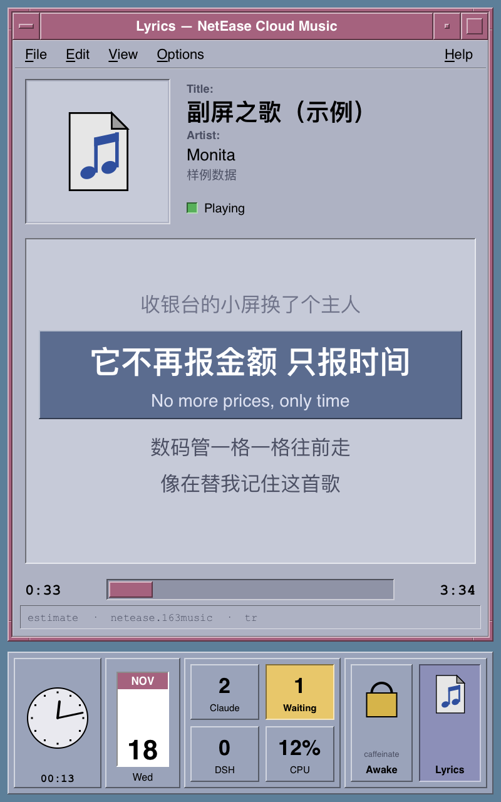
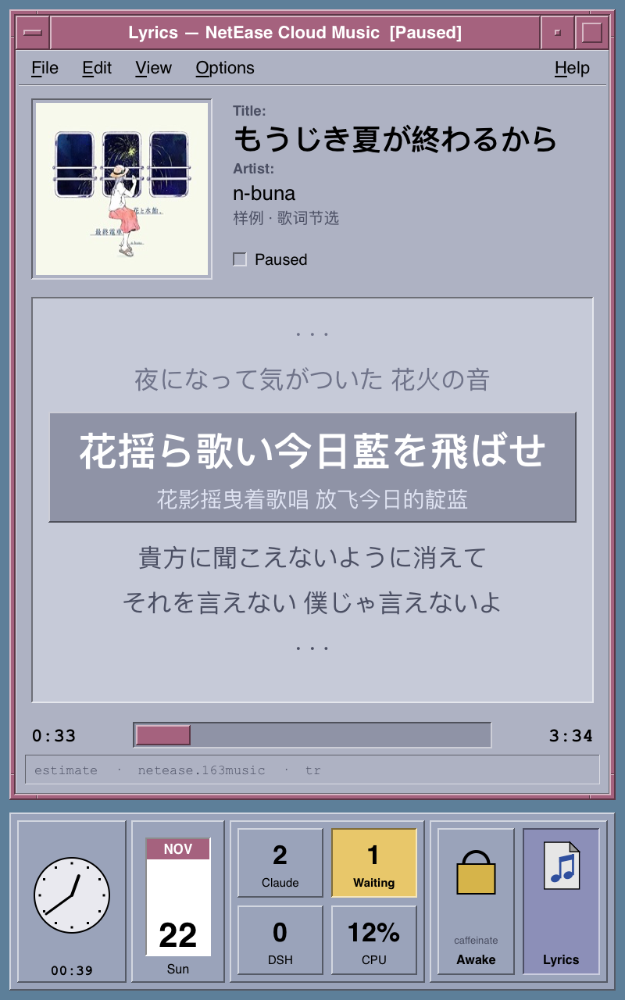
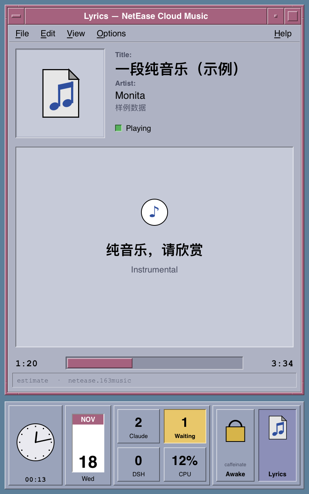
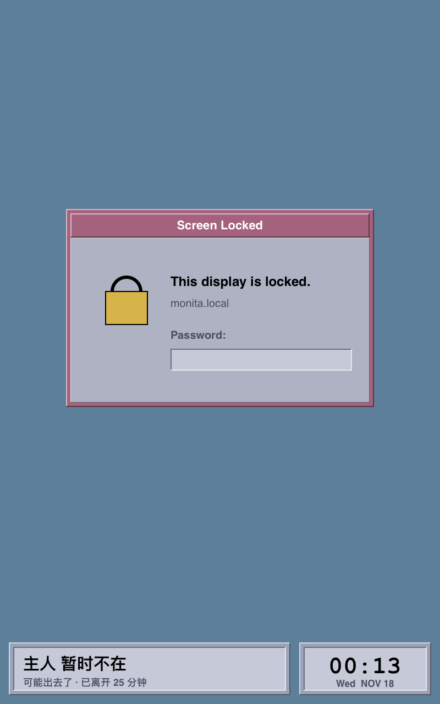
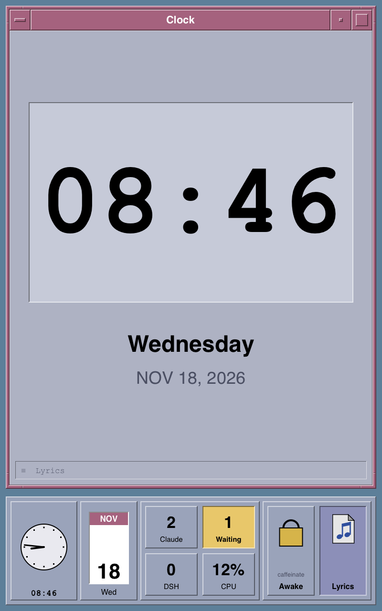
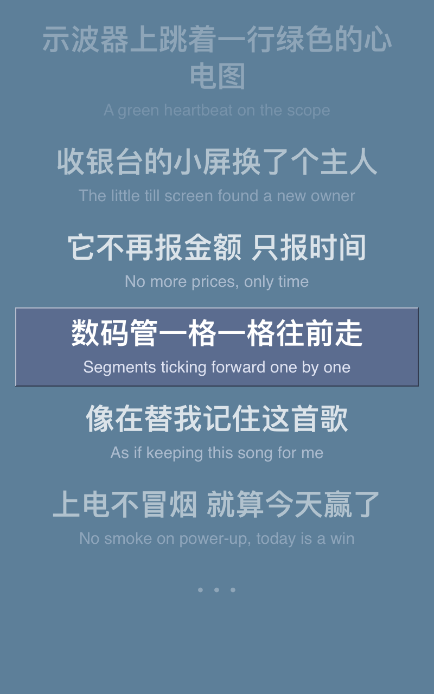
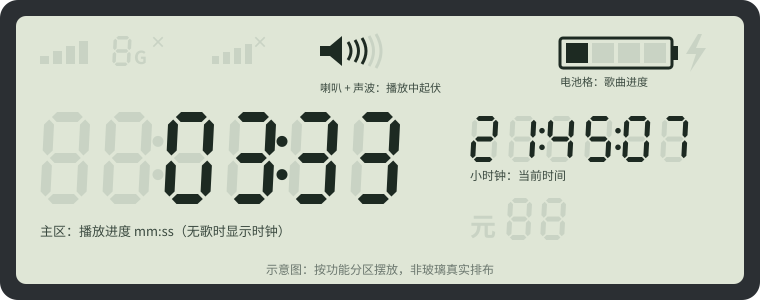

# 模拟太 · Monita-CS80

> 名字借自《逆转裁判》希月心音胸前那台 **モニ太（模拟太）**——只是借个名字。
> 这一只是一台拉卡拉 **CS80 收银客显屏**，原本对着顾客报金额，现在改行给 Mac 当歌词副屏。

800×1280 竖屏放歌词、锁屏留言和一些实时数据；旁边那块段码"数码管"屏，原本显示 `0.00` 元，
现在显示播放进度和时间——它主要是给路过的人看的，炫一下。

**这是基础设施，不是交钥匙方案。** 这里提供的是：能在原厂基带上跑的固件、说清楚的 USB 协议、
逆向笔记，加上一个参考用的上位机（我自己的歌词屏）。渲染单元——屏上画什么、怎么画——
在 vibe coding 的时代自己写并不难，照着协议画你想要的就行。

**不降级基带**：在 Quectel EC600U 的 R05 原厂基带上直接跑我们自己写的原生 app（core_stub 哈希、导出表、
容器格式都已经逆清楚，见 [docs/r05-notes.md](docs/r05-notes.md)）。

> **使用声明**
>
> - 本项目针对**已退役或你自己拥有**的设备，把它改成一块普通的副屏。
> - 刷写需要**物理接触设备**：USB 连线，并在 Windows 上让模组进入下载模式。没有任何远程刷写途径。
> - 固件只做显示（大屏、段码屏、USB 通信），**不涉及任何收款、密钥或支付功能**。
> - 请不要用在别人正在使用的收款设备上。

## 画面

> 下面不是截图——是用 Mac 端**同一套渲染代码**在主机上跑出来的（`monita-cs80 --png … --sample …`），即推到设备上的实际像素。

<table>
<tr>
<td align="center"><br><sub>歌词页 · 播放中</sub></td>
<td align="center"><br><sub>歌词页 · 暂停</sub></td>
<td align="center"><br><sub>纯音乐</sub></td>
<td align="center"><br><sub>锁屏 · 「主人 暂时不在」</sub></td>
<td align="center"><br><sub>时钟页（≡ 键切换）</sub></td>
<td align="center"><br><sub>沉浸模式（查询键长按）</sub></td>
</tr>
</table>

- 歌词页：CDE/Motif 风格。封面、当前句 + 翻译、进度条；底下 Front Panel 是时钟、日历、Claude 会话数 / 等人提醒、CPU、防睡眠状态。
- 锁屏：Mac 锁屏时换成桌面壁纸 + 小时钟 + 留言条（名字可配置；拿不到壁纸时回退成上图的 CDE 锁屏框）。
- 时钟页：按 ≡ 键在歌词页和时钟页之间切换（fw v8）。
- 按键（fw v8）：`+` / `−` 调 Mac 音量，查询键 播放 / 暂停，≡ 切页。状态灯：播放中绿灯常亮；没连上 Mac 时蓝灯 2 s 亮 1 s 灭（同原厂心跳）。
- 沉浸模式（fw v9，还没上机）：整屏只有歌词，当前句大字居中，离得越远越淡；切句时整屏缓动上滚——**滚动只改扫描基址，一个像素都不搬**，
  Mac 只发新露出来的那一句。长按查询键进出，或 `--immersive` 开机就进。

段码屏展示模式（示意图，代码画的，按功能分区摆放，不是玻璃的真实排布）：



## 硬件

| | |
|---|---|
| 设备 | 拉卡拉 CS80 收银客显屏（二手） |
| 模组 | Quectel **EC600U-CN**（UIS8910DM，Cortex-A5，内部 NOR 8 MiB） |
| 基带 | 原厂 R05，**不降级** |
| 大屏 | 800×1280 MIPI，RGB565，video 模式持续扫描；背光 GPIO 开关 |
| 小屏 | FG00 段码 LCD，4 COM × 144 SEG，GPIO 软件模拟 I²C 风格总线 |
| 按键 | 前面板 4 键：查询 = 模组 PWRKEY，≡ / `+` / `−` = GPIO21 / GPIO8 / GPIO23（低有效） |
| 状态灯 | 一颗 RGB 灯：红 GPIO29、绿 GPIO19、蓝 GPIO17，高电平亮，只有亮 / 灭 |
| 连接 | USB（模组的 USB modem 口当数据通道） |

## 工作原理

```
Mac
 ├─ tools/lyrics/lyrics.py serve ── 当前播放(mediaremote-adapter) + 网易云歌词 ──┐ HTTP
 └─ mac/ monita-cs80 (Swift) ◀──────────────────────────────────────────────────┘
       CoreGraphics 画 800×1280 → BGR565 → 32×16 tile 差分
       │
       │  --device usb：IOKit 直接开 USB 接口 7，走 docs/protocol.md 的自有协议
       │  （不加 --device 时兼容旧链路 host 的 HTTP 接口）
       ▼
CS80 (R05 原厂基带 + 我们的 app @0x60270000)
 ├─ 大屏：开机版权页（fw v7）；RECT/COPY 写进后台缓冲，PRESENT 翻页（三缓冲，滚动 ≈ 24 fps）
 │        沉浸模式（fw v9）：整屏是一段"卷轴"，滚动 = 每帧改一次扫描基址（零拷贝，≤ 37.5 fps）
 ├─ 段码屏：Mac 每 250 ms 算一帧发 SEG（进度/时长/Mac 电量）；5 s 没收到时固件自己走时钟
 ├─ 按键（fw v8）→ KEY 事件回传 Mac：音量 / 播放暂停 / 切页
 └─ 状态灯（fw v8）← LED：Mac 播放中绿灯常亮；没连上时蓝灯心跳
```

路线和排期见 [PLAN.md](PLAN.md)。

## 目录

```
fw/                     R05 原生 app
  build.sh              一键：生成桩表 → 编译 → 链接 → 打包 2PPA → 按 loader 规则静态校验
  app.c                 主 app：USB 收帧 → 大屏（三缓冲翻页，拿不到时退回双/单缓冲）/ 段码屏，协议见 docs/protocol.md
  link/                 协议纯逻辑 proto.h · 跨缓冲 COPY blit.h · 三缓冲 tribuf.h · 沉浸模式卷轴 imm.h · 按键 keys.h · 状态灯 led.h
                        · 主机在不在 linkwd.h · 诊断 diag.h / zc_diag.h（主机单测 test.sh）
  io/                   按键 keys_hw.h（3 个 GPIO + PWRKEY 回调）· 状态灯 led_hw.h（3 个 GPIO）
  sdk/                  r05_api.h 导入原型 · gen_stubs.py · pack.py · validate.py · app.ld · r05_exports.csv
  fg00/                 段码屏驱动 fg00.h + 段位映射 segmap.h
  lcd/                  大屏上电/帧缓冲 lcd.h · LCDC 寄存器 lcdc.h · 纯色轮换测试 lcd_test.c
  diag/                 诊断：probe（USB 口心跳）· segtest（888888↔123456）· segprobe（逐段点亮对照）
mac/                    Swift 包 MonitaCS80
  Sources/MonitaCore/   纯逻辑：歌词定位/折行、像素与 tile diff、推帧决策、帧键省电
  Sources/monita-cs80/  渲染器本体（CoreGraphics 画面、锁屏、推帧循环）
  Tests/                swift-testing 用例
  Samples/              预览图用的样例数据（歌词节选自 n-buna《もうじき夏が終わるから》，仅作预览；封面 cover.jpg 不进仓库，没有时按无封面画）
tools/
  host-ref/             Python 参考上位机（pyserial）：握手、推图、差分、测吞吐、撕裂对比
  lyrics/               lyrics.py（当前播放 + 网易云歌词 + 小 HTTP 服务）· lyrics_core.js · build-nowplaying.sh · 测试
  segpreview/           段码屏示意图生成器
docs/
  r05-notes.md          R05 原生 app 笔记：哈希、导出表、loader 规则/签名门、大屏/背光/USB、段码屏协议与坑
  protocol.md           上位机 ↔ 固件协议 v0
  segmap.md             段码屏段位映射
```

## 构建

**固件**（需要 `arm-none-eabi-gcc` 和 Python 3；只编译和静态校验，不连设备）：

```sh
bash fw/build.sh            # app + lcd/lcd_test
bash fw/build.sh all        # 含 diag/
```

产物在 `fw/build/*.bin`，写到 NOR `0x60270000`。刷写要在 **Windows** 上让模组进下载模式（macOS 认不出下载态）。**刷机前务必先做整片备份**，刷写流程和风险见 [docs/r05-notes.md](docs/r05-notes.md)。

**Mac 端**（macOS 13+，Command Line Tools 即可）：

```sh
cd mac
swift run monita-cs80-tests                  # 测试
swift build -c release
.build/release/monita-cs80 --png out.png --sample Samples/lyrics-playing.json   # 出一张预览图
.build/release/monita-cs80 --device usb --lyrics http://127.0.0.1:8788     # 直连 R05 固件（macOS：IOKit 直接开 USB 接口）
.build/release/monita-cs80 --device usb --bench                            # 只测链路：HELLO/PING/整帧+FBCRC/带宽/SEG 时钟
.build/release/monita-cs80 --scroll-sim --sample Samples/lyrics-playing.json   # 离线模拟一次切句滚动（COPY 规划）
.build/release/monita-cs80 --lyrics http://127.0.0.1:8788 --name 主人          # 兼容旧链路 host
```

按键和状态灯（直连 + fw v8 才有，固件 HELLO_ACK 的 `caps` 说了算）：`+` / `−` 用 `osascript` 调系统音量（每下 6/100），
查询键短按 播放 / 暂停（走 mediaremote-adapter 的 `send 2`），
≡ 短按切 歌词页 ↔ 时钟页；播放中绿灯常亮，退出（SIGINT / SIGTERM）时先灭灯。`--no-keys` / `--no-led` 分别关掉；
`--png out.png --clock --sample …` 出时钟页预览。

沉浸模式（直连 + fw v9，`caps` bit6）：查询键**长按**进 / 出，或 `--immersive` 开机就进；锁屏时自动回普通锁屏页，解锁再回来。
设备内存不够开卷轴时（IMM_ENTER 被拒）留在普通歌词页并打日志。`--png out.png --immersive --sample … --at 40` 出预览。

**mediaremote-adapter 放哪**：渲染器（播放/暂停）和 `lyrics.py`（读 Now Playing）用同一套查找顺序，第一个装好了的生效：
设了 `MONITA_MRA_DIR` 就只认它；否则依次找 `$MONITA_HOME/mediaremote-adapter` → `~/.monita-cs80/mediaremote-adapter`（`build-nowplaying.sh` 的默认产物位置）
→ `~/.cs80_panel/mediaremote-adapter`（以前给旧链路 host 编译过的，不用挪）。launchd 起的渲染器不继承 shell 里的环境变量，
装在别处时在 plist 的 `EnvironmentVariables` 里写 `MONITA_MRA_DIR`。

macOS 上模组的串口类接口是厂商类（0xFF），系统不绑驱动、**没有 `/dev/cu.*`**，所以 `--device usb` 用 IOUSBHost 直接打开接口走 bulk
（不要 root；接口是独占的，同一时间只能有一个进程开着）。`usb` = 发 HELLO 自动探测（实测固件在接口 7），也可以写死 `usb:7`。
Linux / 有串口驱动时照旧写串口路径：`--device /dev/ttyUSB0`。
歌词滚动动画（`--no-scroll` 关）要 fw v2 的 COPY；连的是 v1 固件时自动不滚。

**歌词数据源**（只用 Python 标准库）：

```sh
sh tools/lyrics/build-nowplaying.sh          # 一次性：编译 mediaremote-adapter（macOS 15.4+ 拿 Now Playing 需要）
python3 tools/lyrics/lyrics.py serve         # http://127.0.0.1:8788/api/data/lyrics
python3 -m unittest discover -s tools/lyrics/tests
node --test tools/lyrics/tests/
```

## 衍生项目 / Derived projects

同一块拉卡拉 CS80 副屏、同一套 R05 原生 app 底座，换个玩法：

- [monita-x86](https://github.com/uaih3k9x/monita-x86)：在副屏上跑 x86 模拟器（tiny386），启动 FreeDOS / Windows 3.1，Mac 转发键盘鼠标。
- [monita-doom](https://github.com/uaih3k9x/monita-doom)：Doom（doomgeneric）移植，作为 R05 app 直接跑在副屏上，WAD 自备。

<!-- TODO: 两个项目的上机照片（Win3.1 Program Manager / Doom 画面）之后补 -->

## 欢迎贡献

Windows / Linux 上位机非常欢迎有兴趣的朋友来写——我只写了 macOS 的 Swift 版，因为我懒了😂

设备那一侧说的是平台无关的 USB 串口协议（[docs/protocol.md](docs/protocol.md)），能开串口、能画一张 800×1280 的图，
就能当它的上位机。协议还是草案，有想法欢迎开 issue 一起定。

## 参考与致谢

- [StevenLang233/lakala-display-re](https://github.com/StevenLang233/lakala-display-re)（QDisplay）：R03 侧的硬件资料（按键、背光、段码屏候选引脚）。只引用了事实，没有使用其代码。
- [xbsheng/lakala-cs80](https://github.com/xbsheng/lakala-cs80)：Mac 端旧链路 host，本项目暂时通过它的 HTTP 接口推帧；仓库里不包含其代码。
- [ungive/mediaremote-adapter](https://github.com/ungive/mediaremote-adapter)（BSD-3）：macOS 15.4+ 读取 Now Playing。

本项目与拉卡拉、移远（Quectel）无任何关系；仓库里不含任何厂商固件或二进制。改装自己的设备风险自负。

- 开机版权页用的是 [EDK2](https://github.com/tianocore/edk2) 的 UEFI 8×19 字体（`tools/edk2font/LaffStd.c`），授权见 [THIRD_PARTY.md](THIRD_PARTY.md)。

## License

Copyright (c) 2026 uaih3k9x，以 [PolyForm Noncommercial 1.0.0](LICENSE) 发布。

- **非商业使用自由**：个人使用、学习、研究、实验都可以，也可以修改和再分发（需附上许可文本和 `Required Notice` 行）。
- **商业使用需另行授权**：包括但不限于刷机后售卖设备、提供代刷服务、集成进商业产品。请在 GitHub（uaih3k9x）开 issue 联系作者。
- 这是一份"源码可见"（source-available）许可，**不是** OSI 认可的开源协议。
- 例外：开机字体来自 EDK2，BSD-2-Clause-Patent（`tools/edk2font/LaffStd.c` 与生成的 `fw/lcd/font_uefi.h`），见 [THIRD_PARTY.md](THIRD_PARTY.md)。
