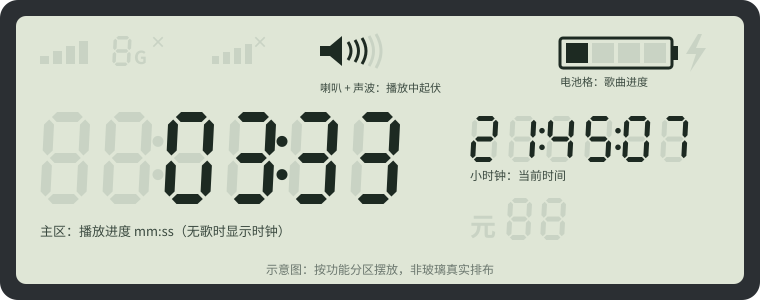
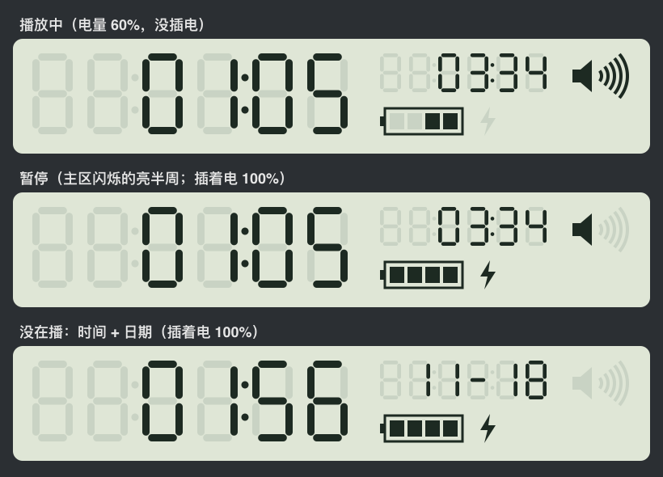

# 段码屏映射

> 状态：屏上所有可见元素都已确认（15 个数字位 + 30 个单段）。
> 实机把其余未覆盖的位逐个点亮过，全都不亮——没有固定图标，未覆盖位都是没接线的 seg。
> 代码里的权威版本是 [`fw/fg00/segmap.h`](../fw/fg00/segmap.h)。

## 寻址

显存 `fb[72]` = 4 COM × 18 字节。段 (com, seg) → `fb[18*com + seg/8]` 的第 `7 - seg%8` 位。

## 7 段数字【证实，实机 123456 笔画全对】

第 k 列（每列占 4 个 COM 平面里的第 k 个字节，只用 bit7/bit3）：

| | bit7 | bit3 |
|---|---|---|
| `fb[k]`（COM0） | f | g |
| `fb[18+k]`（COM1） | a | b |
| `fb[36+k]`（COM2） | e | c |
| `fb[54+k]`（COM3） | d | 图标/小数点槽 |

掩码 bit0..6 = a..g，数字 `0..9 = 3f 06 5b 4f 66 6d 7d 07 7f 6f`，`-` = 40。

| 列 k | 用途 |
|---|---|
| 0..5 | 主数字区 6 位（左→右） |
| 6 | "8G" 里的 8 |
| 8..13 | 小时钟 88:88:88 |
| 14..15 | "元88" 的两位 |

## 单段图标【证实】

| 宏 | 显存位 | 含义 |
|---|---|---|
| `FG_SEG_MAIN_COLON2` / `COLON4` | fb[55] / fb[57] & 0x08 | 主区第 2 / 第 4 位后的冒号 |
| `FG_SEG_MAIN_DP4` / `DP5` | fb[56] / fb[58] & 0x08 | 主区第 4 / 第 5 位后的小数点 |
| `FG_SEG_CLK_COLON_A` / `B` | fb[63] / fb[65] & 0x08 | 小时钟两个冒号 |
| `FG_SEG_YUAN` | fb[59] & 0x08 | "元" 字 |
| `FG_SEG_NET_G` | fb[60] & 0x08 | "8G" 的 G |
| `FG_SEG_NET_X` | fb[25] & 0x80 | "8G" 旁的 × |
| `FG_SEG_SIG1..4` | fb[61]&0x80, fb[43]&0x80, fb[7]&0x80, fb[25]&0x20 | 信号 4 格 |
| `FG_SEG_WIFI0..3` | fb[61]&0x20, fb[7]&0x20, fb[7]&0x08, fb[25]&0x08 | WiFi 4 级 |
| `FG_SEG_WIFI_X` | fb[43] & 0x20 | WiFi 旁的 × |
| `FG_SEG_SPK` | fb[43] & 0x08 | 喇叭本体 |
| `FG_SEG_VOL1..5` | fb[61]&0x08, fb[61]&0x02, fb[43]&0x02, fb[7]&0x02, fb[25]&0x02 | 五道声波 |
| `FG_SEG_BAT_FRAME` | fb[70] & 0x80 | 电池外框 |
| `FG_SEG_CHARGE` | fb[52] & 0x80 | 充电闪电 |
| `FG_SEG_BAT_A..D` | fb[70]&0x40, fb[16]&0x40, fb[16]&0x80, fb[34]&0x80 | 电池四格（A 最左 → D 最右，实机确认；电池图标正极在左） |

注意：原厂的音量函数只管五道声波，喇叭本体单独控制（早期把第一道声波当成了本体，已更正）。

## 展示模式（见 PLAN.md）

段码屏定位是"给别人看的、炫一下"，不承载复杂状态，只做一个简单好看的展示：

| 屏上元素 | 显示什么 |
|---|---|
| 主区 6 位 + 冒号 | 播放进度 `mm:ss`（≥1 小时 `h:mm:ss`），暂停时 1 Hz 闪烁；没在放歌时显示时钟 `hh:mm`（冒号按秒闪） |
| 小时钟 88:88:88 | 播放/暂停时显示歌曲总时长；没在放歌时显示日期 `MM-DD` |
| 喇叭 + 五道声波 | 播放中声波做 1–5 道跳动动画（不读系统音量），暂停时只亮喇叭，没在放歌时全灭 |
| 电池框 + 四格 + 闪电 | Mac 电量（所有模式都显示）：25% 一格四舍五入、>0% 至少 1 格，从负极端（右，D）开始亮；闪电 = 接着交流电；没有内置电池（台式机）整块不亮。30 s 读一次 |
| 其它（元88、8G、信号、WiFi、×） | 先不用，留着以后好玩再加 |

示意图（代码画的，非真实排布）：

实际出图（`monita-cs80 --seg-png`，同一套 SegFrame 代码离线渲染）：

