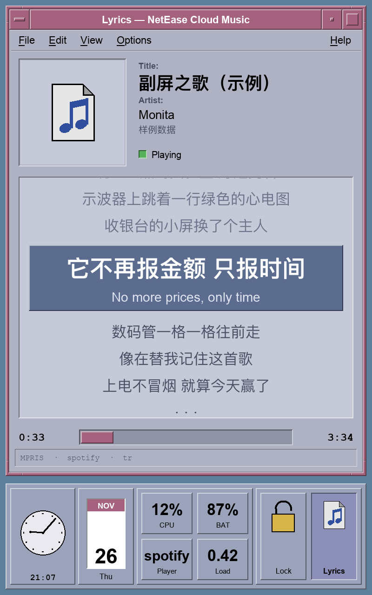
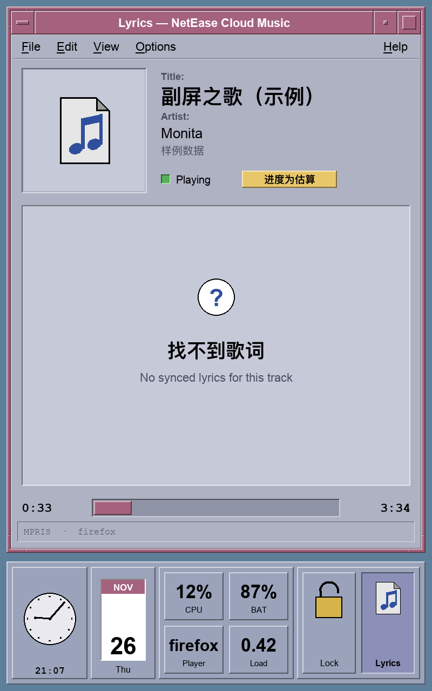
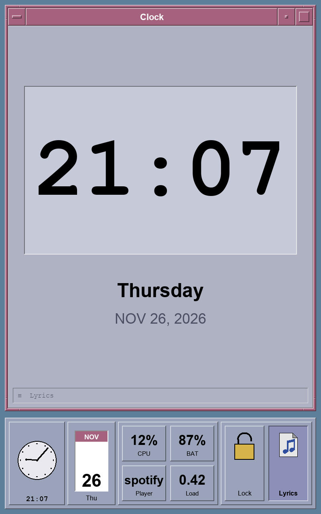

# Monita-CS80 Linux 上位机

让 Linux 桌面也能用这块副屏：读正在播放（MPRIS）、取歌词、画歌词页 / 时钟页、推帧、处理按键、控制灯和段码屏、跟着系统休眠。
画面和 Mac 版是同一套布局（CDE 风格），不追求像素一致。设计和取舍见 [DESIGN.md](DESIGN.md)。

协议层直接复用 `tools/host-ref/monita_link.py`，歌词逻辑直接复用 `tools/lyrics/lyrics.py`；这里只补会话层（keepalive、
推帧判错、SLEEP / 唤醒）、段码屏帧、按键映射、渲染器和 Linux 系统接口。

| 歌词页 | 找不到歌词（进度为估算） | 时钟页 |
|---|---|---|
|  |  |  |

> 预览图是 `--png` 离线渲染出来的（在 Mac 上跑的，字体由 fc-match 回落到 Arial / Courier New / 苹方；Linux 上默认是
> Liberation Sans / Liberation Mono / Noto Sans CJK SC，字形略有不同）。另有 `lyrics-paused.png`、`lyrics-pure.png`、`idle.png`。

## 安装

只要 git clone + 系统包，不打 pip / deb 包。

```sh
# Debian / Ubuntu
sudo apt install python3 python3-pil python3-jeepney python3-usb fonts-liberation fonts-noto-cjk
# Fedora
sudo dnf install python3 python3-pillow python3-jeepney python3-pyusb liberation-fonts google-noto-sans-cjk-fonts
# Arch
sudo pacman -S python python-pillow python-jeepney python-pyusb ttf-liberation noto-fonts-cjk

git clone <本仓库> ~/.local/share/monita-cs80
~/.local/share/monita-cs80/linux/monita-cs80-linux --device usb -v
```

| 依赖 | 用途 | |
|---|---|---|
| Python ≥ 3.9、Pillow | 渲染 | 必需 |
| jeepney | D-Bus：MPRIS、logind | 没有就只显示时钟 / "未在播放"，不处理休眠 |
| pyusb + libusb-1.0 | `--device usb` | 走串口 `/dev/ttyUSB*` 时不需要 |
| pyserial | 串口 | 可选，没有就用 monita_link 自带的 termios 实现 |
| wpctl 或 pactl | 音量键 | 有一个就行，都没有时音量键只打日志 |

只依赖会话 D-Bus（MPRIS）和系统 D-Bus（logind），**不连 X11 / Wayland、不截屏**，GNOME / KDE / sway / i3 都一样。

## 运行

```
monita-cs80-linux [--device usb|usb:N|/dev/ttyUSBn] [--player NAME] [--page lyrics|clock] [--tick 0.2]
                  [--font-sans PATH] [--font-mono PATH] [--font-cjk PATH] [-v]
monita-cs80-linux --png out.png [--sample mac/Samples/lyrics-playing.json [--at 秒]] [--clock]   # 离线出图，不连设备
```

- `--device usb`（默认）：pyusb 打开 2c7c:0901 的接口 7（bulk OUT 0x07 / IN 0x8A）；内核驱动已经绑上时先借过来，退出时还回去。
  接口被占用（EBUSY）时日志会提示改用串口路径。
- `--player`：按 MPRIS 总线名后缀的**前缀**匹配，`chromium`、`firefox`、`vlc` 这类带实例号的也能匹配上。
  不给时：正在播放的优先（多个都在放时不来回跳），都没在放时选最近在放的那个。`playerctld` 代理会被排除。
- 设备不在、被拔掉、休眠后重新枚举：进程不退出，每 2 s 重开端口重连。

### 按键

| 键 | 动作 |
|---|---|
| `+` / `−` | 音量 ±6%（wpctl 优先，没有就 pactl；`+` 顺带解除静音，不超过 100%） |
| `≡` 短按 | 歌词页 ⇄ 时钟页（长按不切） |
| 查询键短按 | 屏上那个播放器 PlayPause（经 MPRIS，不需要 playerctl） |

### 灯、段码屏、休眠

- 灯：播放中绿灯常亮，其余熄灭（Linux 没有 agent 数据源，蓝灯那一档不做）。
- 段码屏：播放中显示进度 mm:ss + 总时长 + 声波；暂停时进度闪烁；没在播显示 HH:MM + 日期；有电池时显示电量格和充电标记。
- 休眠：启动时拿 logind 的 delay inhibitor；`PrepareForSleep(true)` 时发 SLEEP（设备关背光 / 段码屏 / 灯），之后**一个字节都不写**，
  然后才放开 inhibitor；唤醒后重新 HELLO、推整帧、重发灯。拿不到 inhibitor（没有 logind、容器里）只记警告：
  设备会在主机停发约 5 s 后自己回开机页、10 min 后自己休眠。
- 退出（SIGTERM / Ctrl-C）：先灭灯再关端口；设备在睡时不发（任何一帧都会叫醒它）。

## 歌词来源和许可

- 歌词、封面来自**网易云音乐的非官方 Web 接口**（`music.163.com` 的 `/api/search/get`、`/api/song/lyric`、`/api/song/detail`），
  由 `tools/lyrics/lyrics.py` 调用。这些接口**没有公开文档、没有明确许可，随时可能失效或被限流**；歌词和封面的版权归原权利人。
- 仓库只放调用代码，不含任何歌词或封面。本地缓存在 `~/.monita-cs80/lyrics/`（`MONITA_HOME` 可改）。
- 取不到时的提示页：正在查找 → "正在查找歌词…"；找不到 / 接口出错 → "找不到歌词"；纯音乐 → "纯音乐，请欣赏"；没有播放器 → "未在播放"。
  除"未在播放"外，标题、进度条、段码屏照常显示。断网时 30 s 后自动重试。
- 播放器给不出进度（部分浏览器）时，从"第一次看到这首"起估算，页面上标黄框"进度为估算"。
- 封面：优先网易云的（后台线程取，不卡主循环）；没有时用播放器给的 `file://` 封面；`http(s)://` 的封面不取。

## systemd --user 和 udev

示例在 [packaging/](packaging/)：

```sh
cp linux/packaging/monita-cs80.service ~/.config/systemd/user/     # 按 clone 位置改 ExecStart
systemctl --user daemon-reload && systemctl --user enable --now monita-cs80
journalctl --user -u monita-cs80 -f

sudo cp linux/packaging/70-monita-cs80.rules /etc/udev/rules.d/
sudo udevadm control --reload && sudo udevadm trigger            # 再拔插一次设备
```

- 服务挂 `default.target`，不挂 `graphical-session.target`（后者在 sway / i3 下不会启动）。
- udev 规则让 **ModemManager 忽略**这台设备（VID 2c7c 是 Quectel，ModemManager 会去发 AT 命令，打乱协议帧），
  并给当前座席用户 `uaccess`。文件号必须小于 73。
- 无会话（开了 linger、只 ssh 登录）时 `uaccess` 不生效：改用规则里注释掉的组权限那行（`plugdev`；Fedora / Arch 没有这个组，
  建一个或换成你自己的组）；走串口路径时把用户加进 `dialout`。
- 内核的 option 驱动认不认 PID 0x0901 还没验证过：出现了 `/dev/monita-cs80` 就用 `--device /dev/monita-cs80`，否则用 `--device usb`。

## 测试

```sh
python3 -m unittest discover -s linux/tests      # 单测 + fwsim 对拍（约 30 s）；Mac / Linux 都能跑
python3 linux/tests/test_fwsim.py                # 只跑 fwsim 对拍，打印每种配置的结果
sh tools/fwsim/run.sh --python-only              # 现有对拍：monita_link（Linux 版的协议层）在当前固件下仍然全过
```

- Linux 专属的部分（D-Bus、logind、PipeWire、sysfs）都在可替换接口后面，单测用假实现；
  `test_dbus_live.py` 在装了 jeepney + dbus-daemon 的机器上会起一个私有 dbus-daemon，挂假 MPRIS 播放器和假 login1，走真的 D-Bus 线协议
  （variant 拆包、Get / GetAll、PlayPause、PrepareForSleep 信号、Inhibit 的 fd 传递）。
- `test_fwsim.py`：四种模拟器配置（三缓冲 / 单缓冲 / 双缓冲 + 16 KiB / 卷轴不够）并行，各 24 项：连上、整帧和差分后屏上 CRC
  等于本地帧、段码屏、灯、按键（音量、≡ 切页、长按不切）、停 3.6 s 不回开机页、停 5.6 s 回开机页后恢复、SLEEP（关 fd 在 ACK 之后、
  睡着时 rx_bytes 不动）、唤醒、拔线重开端口、退出灭灯。缺字体时用合成画面照样跑，没有 cc 就 skip。

### 待 Linux 实机验证

本机开发环境是 Mac，下面这些只有假实现 / 私有总线覆盖，欢迎在真机上试了反馈：

- 真实 MPRIS 播放器（Spotify、mpv、浏览器）；浏览器播放器（实例号、Position 缺失）的降级显示；
- logind 挂起和唤醒；wpctl / pactl；
- udev 规则（含 ModemManager 忽略是否生效、无会话时的组权限）；内核驱动绑定时的 detach 路径；
- sway / i3 这类不启动 graphical-session.target 的环境下服务能否自启；
- 真设备上的 pyusb 直连（`--device usb`）。

## English

A Linux host for the Monita-CS80 secondary display (custom R05 firmware). It reads "now playing" over MPRIS (D-Bus),
fetches synced lyrics via `tools/lyrics/lyrics.py` (unofficial NetEase Cloud Music web endpoints — undocumented, no explicit
license, may break at any time; lyrics/covers belong to their owners and are never committed), renders the same CDE-style
lyrics / clock pages as the Mac host with Pillow, and talks the repo's protocol (`docs/protocol.md`) over pyusb
(interface 7, bulk OUT 0x07 / IN 0x8A) or a tty. Front-panel keys map to volume (wpctl / pactl), page toggle and
MPRIS PlayPause; the LED, segment display and logind sleep/wake (SLEEP before suspend, re-HELLO + full frame on resume)
are handled too. It needs no X11/Wayland. Dependencies: Python ≥ 3.9, Pillow; optional jeepney, pyusb, pyserial.
Run `linux/monita-cs80-linux --device usb`; see `packaging/` for a systemd --user unit and udev rules, and run
`python3 -m unittest discover -s linux/tests` for the tests (including a firmware-simulator run, `tools/fwsim`).
Linux-only pieces are behind small interfaces and tested with fakes; real-hardware Linux testing is still welcome.
